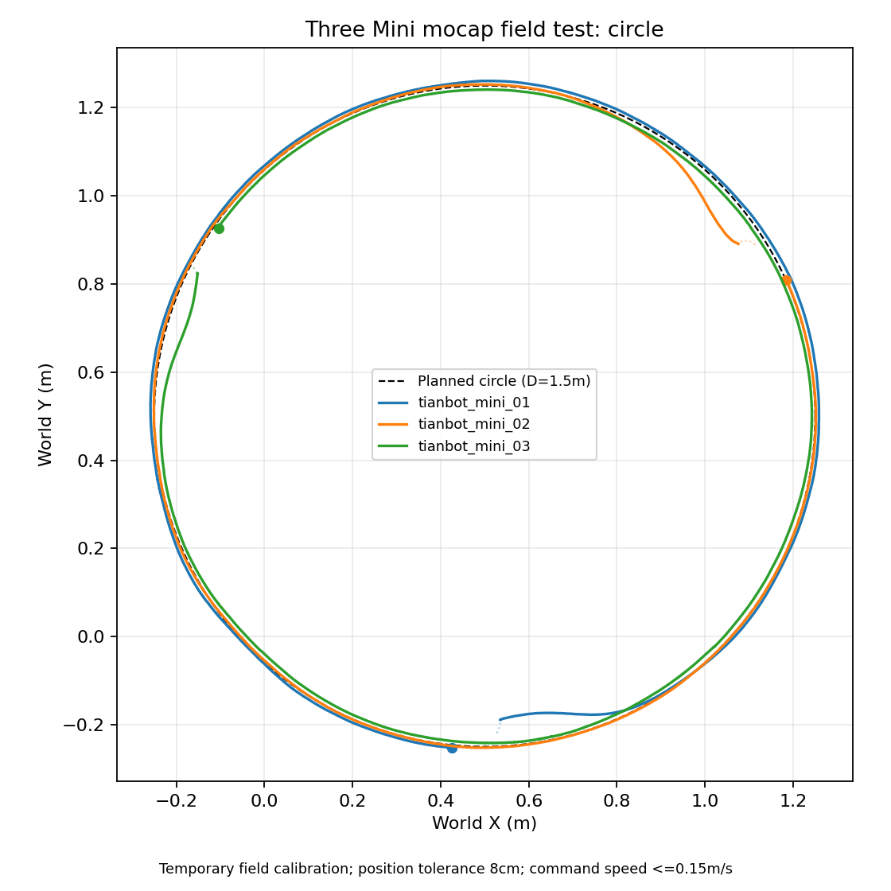

# 三台 Mini 动捕实验：四项现场使用

ROS1 Noetic；本页统一四个独立实验的准备、摆位、启动和停止。直接使用仓库 launch，不依赖 `/tmp` 测试脚本或额外的临时 TF 进程。

| 项目 | 控制关系 | 操作方式 |
| --- | --- | --- |
| 三角形 leader–follower | 02、03分别跟随01 | manual键盘；auto头车画圆 |
| 蛇形 leader–follower | 01→02→03，逐车跟随前车 | manual键盘；auto头车画圆 |
| 三车同圆协调路径跟踪 | 同一个圆约120°间隔，同向绕行 | 自动入位后运行 |
| 三车正三角形协调路径跟踪 | 每车从一个顶点沿直边去下一顶点，到齐再转向 | 自动入位后运行 |

后两项使用 Pure Pursuit 几何路径控制和组间同步；点镇定与可选 ORCA 是它们的入位步骤。

四项现在都可通过control_config使用同一份逐车标定；leader–follower默认先自动入队，速度反馈来自动捕。`startup:=false`才使用旧式直接跟随及底盘odom，不使用本流程的标定。若已在动捕软件修正刚体方向/原点，须更新或清空现场YAML中的旧补偿，避免重复校正。

默认ORCA按直径15cm的Mini配置：车体半径7.5cm、每车余量1cm、前置距离4cm，有效圆心间距门槛25cm；不是实际车体直径。起始包络仍不能重叠，参数和参考点解释见[ORCA说明](orca.md)。

两个跟随实验的完整顺序为ORCA入队 → 受几何监控的纯点镇定 → 全体稳定到齐 → following。入队期间键盘请求丢弃，到following后重新操作；不需要启用service。切换条件、配置和GUI接口见[完整流程](formation-workflow.md)。

## 准备一次后台

三台 Mini 进入集群模式：按住配网/WIFI键，点击 Reset，随后松开配网键，状态灯变蓝。车辆与电脑连接同一局域网，rmip 指向运行底盘驱动的电脑，端口11411。蓝灯后仍需核对实际连接。

每个终端加载环境。下面 `.106` 是当日控制电脑地址，换电脑/网络后改成实际地址：

```bash
source /opt/ros/noetic/setup.bash
source ~/tianbot_mini_ws/devel/setup.bash
unset ROS_HOSTNAME
export ROS_IP=192.168.2.106
export ROS_MASTER_URI=http://localhost:11311
export ABC_SWARM_FIELD_CONTROL="$(rospack find abc_swarm)/config/mocap_field_control_20261026.yaml"
```

后台没有启动时，在一个终端运行：

```bash
roslaunch "$(rospack find abc_swarm)/launch/common/mocap_backend.launch.xml" vrpn_server_ip:=192.168.2.101
```

默认机器人与刚体对应 `tianbot_mini_01/02/03`，动捕 server 为 `.101:3883`。底盘 rmip `.106` 与动捕 server `.101` 用途不同。退出旧运动算法，每次只运行一个实验。

## 1. 三角形 leader–follower

三车同向，以01车头为前方：02放在01后方0.5m、左侧0.5m；03放在后方0.5m、右侧0.5m。spacing表示纵/横偏移，不是等边三角形边长。无需精确摆到目标，但起始包络不能重叠，通道需留开；启动后会自动入队。01初始位姿冻结为目标，必要时也可能为避让短暂移动，再回到目标。

```bash
roslaunch abc_swarm demo_mocap_three_mini_leader_follower_triangle.launch mode:=manual spacing:=0.5 max_linear:=0.15 control_config:="$ABC_SWARM_FIELD_CONTROL" velocity_source:=mocap start_driver:=false start_vrpn:=false
```

默认弹出键盘终端；先自动入队，状态到following后在里面操作01。02、03都直接跟随01，不依次跟随。先走缓慢直线，再做缓弯。

键盘初始直线速度使用max_linear（默认0.15m/s），初始转速由teleop_angular设置（默认0.6rad/s），角速度上限max_angular默认为3.14rad/s。e/c每次增加/降低转速10%，因此0.6→0.66会实际提高请求，不再从启动起就撞上同一个上限。超限请求会在demo终端明确提示；实际头车输出仍可能因编队误差而降低。

按当前Mini URDF左右轮joint的y=±0.0539m，轮距为0.1078m；Gazebo插件配置轮距0.1m、轮径0.043m，与joint位置及轮子STL约44.5mm外廓存在差异，此处不修改上游模型。若每轮最高线速约0.3m/s，则纯原地转向理论角速度为2×0.3/0.1078≈5.57rad/s；3.14rad/s对应每轮约0.169m/s。这是模型和操作者轮速估计的运动学换算，不是实车测得上限。带前进速度时轮速为v±ωB/2，可用角速度会更低；后车0.15m/s平移上限也会限制整队绕头车旋转的速度。

启动demo的终端会打印“入位完成，可以遥控头车”，此时再操作键盘；该提示在demo终端，不在Xterm的按键帮助中。auto模式相应提示“入位完成，开始自动领航与编队跟随”。

改为自动领航，01走圆，02、03继续分别跟01：

```bash
roslaunch abc_swarm demo_mocap_three_mini_leader_follower_triangle.launch mode:=auto radius:=1.0 laps:=1 max_linear:=0.15 control_config:="$ABC_SWARM_FIELD_CONTROL" velocity_source:=mocap start_driver:=false start_vrpn:=false
```

## 2. 蛇形 leader–follower

三车同向排成一列：02在01后方0.5m，03在02后方0.5m（距01约1m）。

```bash
roslaunch abc_swarm demo_mocap_three_mini_leader_follower_snake.launch mode:=manual spacing:=0.5 max_linear:=0.15 control_config:="$ABC_SWARM_FIELD_CONTROL" velocity_source:=mocap start_driver:=false start_vrpn:=false
```

键盘遥控01，02跟01、03跟02。键盘操作：i前进，u/o左右缓弯，k停止头车请求；松开后请求超时也会停止。k之后后车仍可能收敛，整组结束必须在启动demo的roslaunch终端Ctrl+C。

前车持续静止后，后车会收敛完整位置和朝向，phase为holding_*；头车的新运动请求会立即切回跟随。停止头车请求后，后车仍可能调整。参数与状态说明见[静止位姿保持](formation-workflow.md#前车停止后的完整位姿保持)。

manual跟随没有指定圈数，不自动结束。两种模式默认使用动捕实测速度；也可显式选择velocity_source=odom，入队时需三台有效odom。

蛇形自动领航：

```bash
roslaunch abc_swarm demo_mocap_three_mini_leader_follower_snake.launch mode:=auto radius:=1.0 laps:=1 max_linear:=0.15 control_config:="$ABC_SWARM_FIELD_CONTROL" velocity_source:=mocap start_driver:=false start_vrpn:=false
```

mode仅支持manual和auto，省略时仍为manual，其他拼写报错。manual默认启动key teleop，可用start_teleop=false供GUI复用；auto不启动键盘，即使start_teleop=true也不会产生键盘节点。模式在启动时选择，切换先Ctrl+C退出，再改mode重启。

auto默认radius=1.0m（头车圆直径2m）、laps=1、clockwise=false，max_linear同时控制头车路径速度上限和后车限速，默认0.15m/s。radius可设0.75得到头车直径1.5m的圆。头车圆心在其启动朝向左侧一个半径处，clockwise=true改为右侧；后车扫掠范围更大。auto在ORCA入队、精定位、全体稳定到齐后出发，路径完成后再次收敛并整组停车，无人工启用步骤。跟随误差增大时头车会降速等待，tracking_window默认0.15m；max_linear是上限而非恒速。它仍是leader–follower编队，三个机器人不会按120°分布在同一个圆上。

## 本次现场配置

公共准备中已选择现场配置，也可在算法终端单独设置：

```bash
export ABC_SWARM_FIELD_CONTROL="$(rospack find abc_swarm)/config/mocap_field_control_20261026.yaml"
```

当前示例使用**2026-10-26现场配置**：保持4cm最终位置容差，仅对02加载原地转动拟合得到的前方3.351cm、左侧0.209cm位置偏移；01/03为恒等转换，不表示已重新标定。三个yaw_offset都为0，不引入新的航向修正。该拟合尚待实车加载后验证，不是通用设备参数；不会覆盖原始动捕TF。

旧的config/mocap_field_control.yaml保留10月25日记录，包含02约115°航向补偿和8cm容差，不应直接用于当前刚体定义。更换标记架、重新建立刚体或修改原点后需重新核对；若已在动捕软件将原点对准轴心，必须清空相应位置补偿，避免重复校正。

节点内部使用校正后的水平控制位姿进行目标定位、速度估计和控制；`/abc_swarm_demo/control_poses` 按机器人顺序发布这些位姿，RViz可添加 PoseArray 查看。原 `rigid_body_N` 仍指向原始动捕刚体，不要再启动昨天的临时 `_field_control` TF 适配进程。

## 3. 三车同圆协调路径跟踪，一圈

直径1.5m，圆心固定在 world `(0.5,0.5)`，第一起点 `(0.5,-0.25)`，逆时针：

```bash
roslaunch abc_swarm demo_mocap_three_mini_circle_tracking.launch diameter:=1.5 speed:=0.15 laps:=1 reference:=world origin_x:=0.5 origin_y:=-0.25 origin_yaw:=0.0 control_config:="$ABC_SWARM_FIELD_CONTROL" velocity_source:=mocap avoidance:=orca start_driver:=false start_vrpn:=false
```

## 4. 三车正三角形协调路径跟踪，一圈

边长1.5m，三个顶点约为 `(-0.25,-0.25)`、`(1.25,-0.25)`、`(0.5,1.049)`：

```bash
roslaunch abc_swarm demo_mocap_three_mini_triangle_tracking.launch side_length:=1.5 speed:=0.15 laps:=1 reference:=world origin_x:=-0.25 origin_y:=-0.25 origin_yaw:=0.0 control_config:="$ABC_SWARM_FIELD_CONTROL" velocity_source:=mocap avoidance:=orca start_driver:=false start_vrpn:=false
```

两条命令都在定位有效后自动入位、调整出发朝向，然后执行任务，不需要启用 service。三角形每轮各走一条直边，到齐停车、原地转向，再一起走下一边；三条边为一圈。`speed=0.15` 是指令上限，转弯、靠近目标和等慢车时会降速。ORCA只用于入位，路径段没有全程避障。

以上坐标描述控制中心参考线，车辆外形会超出图形边界。换场地先调整 world 原点与尺寸；需要按01启动位姿放置图形时，使用 `reference:=initial_leader origin_x:=0 origin_y:=0 origin_yaw:=0`。圆直径用 diameter，三角边长用 side_length；两者支持1.5m及以上，原入口默认仍为2m。

## 观察、停止和重来

```bash
rostopic echo /abc_swarm_demo/status
```

前两项统一使用mode=leader_follower，control_mode显示manual/auto；stage=following时才接收新遥控或执行头车路径。入队期间旧请求丢弃，不跨反馈中断重放。waiting/fault时查看reason。第3/4项的stage顺序为 assembling → tracking_circle/ tracking_edge → turning/finishing → completed；按现场命令运行会看到velocity_source=mocap，mocap_calibrated表示是否显式启用了补偿，校准后清空补偿则为false。mocap速度模式使用约0.2秒控制中心位姿窗口估计实测速度，不等待底盘odom；odom仍可单独用于驱动诊断。动捕过期仍全组输出零，恢复后继续冻结的任务。车辆本身仍需连接底盘驱动接收命令。

完成后持续停车。在实验终端 Ctrl+C 退出，确认三车静止；后台保留。下一轮重新启动同一命令。出现 fault 先检查 reason，再退出/摆位/重启。不要同时运行旧测试脚本、另一套轨迹或直接发布 cmd_vel 的遥控。

## 本轮收口的验证范围

- 1.5m圆：现场录包出现 completed；最大路径误差约6.7cm，RMS约1.3～1.5cm，最终位置误差约6.9～7.5cm，符合当轮8cm容差。该轮使用临时02航向补偿，尚未包含后来整理的完整控制中心校准和动捕速度模式。
- 1.5m三角：用户反馈已运行；自动录包中进入过 tracking_edge，最后一份自动记录因无进展退出，未记录三边完整 completed，不记为完整一圈验收通过。
- 2m圆/三角、顺时针实车、收口后正式配置：本轮不追加实车测试，待下次现场验收。
- 临时补偿和速度模式已收进共享节点及显式配置，离线/私有ROS验证另记录在开发说明，不把它当作新增实车结果。

当日圆形录包的轨迹图（浅色虚线为入位，彩色实线为运行，黑色虚线为参考圆）：



通用任务参数见[协调轨迹说明](coordinated-tracking.md)，车车避让见[ORCA说明](orca.md)，详细现场记录见[测试清单](field-test.md)。
